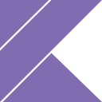
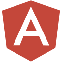

### Hi there, I'm Willem-Jan Boogerd 👋

- 🔭 I’m currently working as a Freelance Full-stack Tech Lead Developer.
- 🌱 I’m currently learning Kotlin Multi-Platform (KMP).
- 📫 How to reach me: [LinkedIn](https://www.linkedin.com/in/wjboogerd/).
- 💬 Ask me about 🤿 diving!

#### 📝 Languages

 
 
 
 
 
 
 

#### 🛠️ Tools
 
 
 

#### 🏗️ Frameworks
 
 
 
 
 

<!--
- 👯 I’m looking to collaborate on ...
- 🤔 I’m looking for help with ...
- 😄 Pronouns: ...
- ⚡ Fun fact: ...
-->
